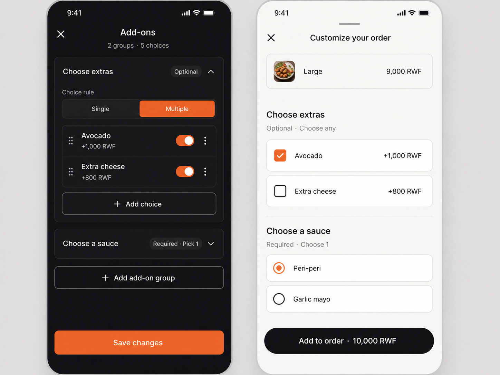

# Add-ons UI/UX proposal — approval gate

Status: APPROVED 2026-08-26 · IMPLEMENTED · RELEASED 2026-08-27
Date: 2026-08-25

## Fit in the existing flow

- In the KDS menu-item modal, tapping the existing **Add-ons** row opens an
  in-modal subview. It does not stack a second modal, and Back returns to the
  item editor without losing unsaved name, pricing, photos, or description.
- A Vendor creates named groups such as **Choose extras** or **Choose a sauce**.
  Each group can be Optional or Required and Single choice or Multiple choice.
- Each choice has a customer-facing label, an optional non-negative RWF
  surcharge, an availability toggle, reorder, and delete controls. The first
  screen remains compact; choice details expand only while being edited.
- On the storefront, add-ons appear in the existing Customize your order sheet
  after size selection and before special instructions. Required groups block
  the Add to order action until satisfied. Every selection updates the live
  item and CTA total immediately.

## Proposed first-version rules

- Add-ons belong to one menu item; they are not a shared Vendor library yet.
- Up to 6 groups per item and 12 choices per group.
- Single-choice groups allow at most one selection. Multiple-choice groups have
  a configurable maximum; a required multiple-choice group has a minimum of 1.
- A surcharge may be `0 RWF`, allowing included choices such as sauce selection.
- The future server implementation must resolve current size and add-on prices,
  then snapshot the chosen group/choice labels and prices onto the order. The
  browser must never supply authoritative prices.
- Add-on surcharge is applied once per item unit, then multiplied by cart
  quantity. Example: Large `9,000` + Avocado `1,000`, quantity 2 = `20,000 RWF`.

## Approval decisions

Please approve or revise these points before implementation:

1. The in-modal Vendor subview and storefront placement.
2. Optional/Required plus Single/Multiple as the group rule model.
3. The proposed limits: 6 groups, 12 choices per group.
4. Free (`0 RWF`) choices and per-unit quantity pricing.
5. Item-specific groups only for v1; a reusable add-on library stays deferred.

No add-ons schema, Store method, checkout logic, order snapshot, KDS ticket,
receipt, migration, deployment, or production data change is included in this
proposal.

Implementation and release truth now lives in issue 01 and ADR-0071. The
shipped add-ons subview also includes an explicit `Save add-ons` action so
Vendors can persist the guarded menu-item update without returning to the
parent form first.
