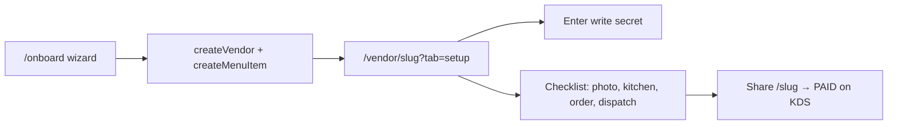

# Vendor onboarding flow — design

**Status:** ready-for-agent  
**Parent PRD:** `.scratch/vendor-onboarding/PRD.md`  
**Last updated:** 2026-06-30

This document turns the Part 6 inventory into a concrete flow: provisioning seam,
field classification, wizard steps, and how they relate to the existing KDS Setup
checklist (`lib/vendor/onboarding.ts`, `SetupDrawer.tsx`).

---

## Goals

1. **~1 minute go-live** — vendor can accept a simulated MoMo order with the minimum
   code-enforced path: Vendor record + unique slug + ≥1 available priced menu item.
2. **No competing data paths** — all writes through Store + Server Actions.
3. **Reuse KDS** for everything the product already ships (menu CRUD, photos, kitchen
   toggle, operational checklist, write-secret).
4. **Honest about auth** — interim `PROVISION_SECRET` gate (same deployment model as
   `VENDOR_WRITE_SECRET` per ADR-0009) until candidate #12.

---

## Two onboarding layers

| Layer | When | Surface | Purpose |
|-------|------|---------|---------|
| **A — Account provisioning** | Before first customer order | `/onboard` wizard | Create Vendor + first menu item; hand off URLs |
| **B — Operational onboarding** | After vendor exists | KDS Setup drawer + coachmarks | Photos, kitchen open, first paid order, dispatch (existing ADR-0012) |

Layer A is **new** (candidate #15). Layer B **already ships** — extend, do not replace.

---

## Provisioning seam decision

### Add to Store (`lib/store/types.ts`)

| Verb | Signature | Notes |
|------|-----------|-------|
| `isSlugAvailable` | `(slug: string) => Promise<boolean>` | Normalized slug; false if taken |
| `createVendor` | `(input: CreateVendorInput) => Promise<Vendor>` | Inserts Vendor; `kitchenOpen` default true, `isActive` default true |
| `updateVendor` | `(vendorSlug: string, input: UpdateVendorInput) => Promise<Vendor \| null>` | Profile fields only; slug immutable after create |

### Types (`lib/types.ts`)

```ts
export interface CreateVendorInput {
  name: string;
  slug: string;
  phoneNumber: string;
  momoCode: string;
  tagline?: string;
  location?: string;
  deliveryTime?: string;
}

export interface UpdateVendorInput {
  name?: string;
  phoneNumber?: string;
  momoCode?: string;
  tagline?: string;
  location?: string;
  deliveryTime?: string;
  rating?: number;
}
```

**Not in v1:** `updateVendorSlug` (slug change breaks URLs; operator-only migration later).

### Server Actions (`lib/actions/vendor-provision.ts`)

- `checkSlugAvailable(slug)` — public read; rate-limit later (#13).
- `provisionVendor(provisionSecret, input, starterItem?)` — guarded create:
  1. `assertProvisionSecret(provisionSecret)` (new `lib/vendor/provision-secret.ts`, mirrors write-secret).
  2. `createVendor(input)`.
  3. If `starterItem` provided: `createMenuItem(slug, { name, priceRwf, category: "General" })`.
  4. Return `{ vendor, menuItem? }`.

**Atomicity:** Prisma adapter may wrap steps 2–3 in one transaction inside the action
(or a package-private helper). In-memory adapter: sequential calls suffice for tests.

**Why not only seed/CLI?** Seed remains for demo (`inka-steakhouse`). Product onboarding
needs a browser path; Store verb keeps adapters testable and avoids ad-hoc Prisma in routes.

### Guard model (until auth #12)

| Env var | Who holds it | Protects |
|---------|--------------|----------|
| `PROVISION_SECRET` | Operator shares with new vendor once | `provisionVendor` |
| `VENDOR_WRITE_SECRET` | Operator shares with kitchen staff | Menu CRUD, images, export (existing) |

Wizard UI: vendor enters provision secret on step 0 (or a dedicated gate screen), stored
in `sessionStorage` for the wizard session only — **not** `localStorage` (unlike write-secret).

Prod: if `PROVISION_SECRET` unset, `/onboard` shows operator-contact message (fail closed).

---

## Field classification

### Wizard (Layer A) — required before go-live

Collected in `/onboard` because no other UI exists and storefront/KDS depend on them.

| Field | Wizard step | Validation | Why here |
|-------|-------------|------------|----------|
| `name` | 1 — Business | Non-empty, ≤80 chars | Storefront hero, receipts |
| `slug` | 1 — Business | `^[a-z0-9]+(?:-[a-z0-9]+)*$`, unique via `isSlugAvailable` | Routes for storefront + KDS |
| `phoneNumber` | 1 — Business | `normalizePhone`, ≥10 digits | Ops contact; future WhatsApp (#9) |
| `momoCode` | 1 — Business | Non-empty | Schema required; future real MoMo (#11) |
| First item `name` | 2 — First dish | Non-empty | Minimum orderable catalog |
| First item `priceRwf` | 2 — First dish | Integer > 0 | Checkout total |
| `provisionSecret` | 0 — Gate | Matches env | Spam guard until auth |

**Defaults applied server-side (not asked):** `isActive: true`, `kitchenOpen: true`,
first item `isAvailable: true`, `category: "General"`, gradient thumbs if no image.

### KDS Setup / Menu (Layer B) — defer, product already covers

| Field / action | Default on create | Where vendor completes |
|----------------|-------------------|------------------------|
| Write secret | Operator sets env | Setup drawer (existing) |
| Tagline | Storefront shows "Premium grills" | **New:** Setup "Storefront profile" (issue 04) |
| Location | "Kigali, Rwanda" | Setup profile |
| Delivery time | "30–40 min" | Setup profile |
| Rating | 4.8 in UI if unset | Setup profile (optional) |
| Menu photos | Gradient thumb | Menu tab + checklist step `hasPhoto` |
| Descriptions, categories | Empty / General | Menu item edit |
| Kitchen open | `true` | Header toggle + checklist `kitchenOpen` |
| More menu items | — | Menu tab |
| First paid order | — | Checklist `hasFirstOrder` |
| Dispatch | — | Checklist `hasDispatch` |
| Drivers | Empty dispatch list | Operator seed (no UI) |

### Operator-only (not in vendor UI v1)

- `DATABASE_URL`, `BLOB_READ_WRITE_TOKEN`, secret rotation
- `isActive` suspension
- Driver records
- Per-vendor provision secret (single deployment secret until #12)

---

## Wizard UX (`/onboard`)

**Visual:** DESIGN.md light editorial (customer-adjacent, not `.kds-dark`). Mobile-first,
single column, ink pill CTAs.

### Step 0 — Gate (if `PROVISION_SECRET` set)

- Copy: "Enter your setup code from ZanTap."
- Password input → `sessionStorage['zantap:provision-secret']`.
- Skip step when env unset (dev only — document in `.env.example`).

### Step 1 — Business

- **Restaurant name** (text)
- **Storefront URL** — live preview `zantap.app/{slug}`; auto-slug from name on blur;
  manual edit; async "available" / "taken" from `checkSlugAvailable`.
- **Phone** — Rwanda MoMo / ops number.
- **MoMo merchant code** — helper text: "Used when live mobile money is enabled."

### Step 2 — First dish

- **Dish name**, **Price (RWF)**.
- Optional skip is **not** allowed — go-live requires ≥1 item (PRD §6.1). Copy: "Add one
  dish now; you can add more in your kitchen dashboard."

### Step 3 — You're live

- Success state with copy-paste links:
  - **Customer menu:** `/{slug}`
  - **Kitchen dashboard:** `/vendor/{slug}`
- Primary CTA: "Open kitchen dashboard" → `/vendor/{slug}?tab=setup`.
- Secondary: "View my menu" → `/{slug}`.
- Reminder: "Enter your write secret in Setup to edit the menu and upload photos."

**Target time:** Steps 1–2 ≤ 60 seconds for a motivated vendor (3–5 fields + one dish).

---

## KDS handoff



On first KDS load after provision:

- `hasMenuItem` checklist step **already complete** (wizard created item).
- Setup drawer opens via `?tab=setup` query (existing tab routing).
- Coachmarks unchanged (ADR-0012).

**Copy fix (issue 04):** Kitchen-closed coachmark claims customers cannot order when closed;
storefront does not enforce (PRD §1.9). Soften to "Let customers know you're accepting orders"
until storefront gate ships.

---

## Out of scope (this candidate)

- Vendor login / sessions (#12)
- Live MTN MoMo (#11) — `momoCode` collected for schema/future only
- Customer storefront DESIGN.md migration (#10)
- Driver CRUD, opening hours, delivery fees
- Public unauthenticated `/onboard` without provision secret in production
- Slug rename, multi-location, invite codes (future)

---

## Issue slice (implementation order)

| # | Card | Delivers |
|---|------|----------|
| 01 | `store-vendor-provision` | `createVendor`, `updateVendor`, `isSlugAvailable` + contract tests |
| 02 | `provision-actions-and-guard` | `PROVISION_SECRET`, `provisionVendor`, `checkSlugAvailable` |
| 03 | `onboard-wizard-ui` | `/onboard` 3-step wizard + success handoff |
| 04 | `kds-setup-profile-and-copy` | Setup drawer storefront profile + checklist copy |

Issues live under `.scratch/vendor-onboarding/issues/`.

---

## Verification

- **Contract:** Store adapters — slug collision, create defaults, update partial fields.
- **Integration:** `provisionVendor` → `getVendorBySlug` + `getAvailableMenu` length ≥ 1.
- **Manual:** Complete wizard → storefront shows hero name + dish → checkout MoMo sim →
  order on KDS → Setup checklist ≥ 1/5 (menu item pre-checked).
